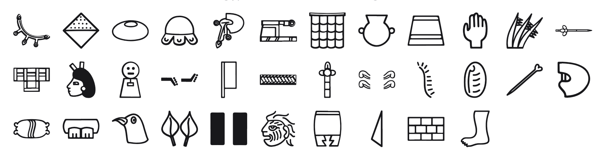

<br/>
<br/>
<br/>
<br/>
<br/>
<br/>
<br/>

<h3 align='center'>aztec-hieroglyph</h3>
<p align='center'>
  An Aztec Hieroglyphic Font
</p>

<br/>
<br/>
<br/>

## Introduction

**MarkAztecHieroglyph** preserves the glyphs of
[Aztec writing](https://en.wikipedia.org/wiki/Aztec_writing), the
pictographic and phonetic system used by the Nahuatl-speaking peoples of
central Mexico. Painted into screenfold codices and carved into stone,
it flourished from roughly **1300 CE** through the Spanish conquest and
into the early colonial period.

Aztec writing blended logographic signs, ideograms, and a rebus-like use
of phonetic syllables, often to spell the names of people and places.
This font gathers a set of those **syllabic signs**, the sound-carrying
building blocks the scribes used to write Nahuatl words.

## Background

Each glyph is a **cleaned and redrawn** version of a sign from the Aztec
codices and inscriptions, keyed by the Nahuatl syllable it represents
(`a`, `ka`, `tla`, `xo`, and so on). Aztec signs vary widely in
proportion, with some tall and narrow, others wide and squat. The font
preserves these natural proportions, scaling each glyph uniformly by
height and adjusting its advance width to match.

It's not meant as an academic reconstruction, but as a **visual
bridge**, a way to appreciate the aesthetic and spirit of Aztec writing
without getting lost in the technical layers of its scholarship.

## Font

| font family | signs | code points |
| :---------- | :---- | :---------- |
| `MarkAztecHieroglyph` | 34 | U+F0000 to U+F0021 |

Every sign sits on its own code point in Unicode's plane 15 private use
area. No sign is on a real Unicode character, so a sign copied out of
this font never pastes as another script's letter, and no other font
draws one by mistake. A private use point means something only in this
font: text written in it should keep each sign's name beside it.

The points are fixed in [`code-points.json`](../../code-points.json) at
the package root, keyed `aztec-hieroglyph/<sign name>`, and never move. Each
sign's name and point are in [`./base/mapping.json`](./base/mapping.json),
in sign order. Signs are named by the syllable each writes (`a`, `ka`, `tla`).

To type or copy a sign, find its name in `mapping.json` and write its
point in text set in `MarkAztecHieroglyph`: `a` is U+F0000, written
`&#xF0000;` in HTML or `'\u{F0000}'` in JavaScript. Or open [`./test/grid.html`](./test/grid.html)
in a browser, which shows every sign with its name and point on hover,
and copy from there.

Fonts are in the
[`./base`](https://github.com/cluesurf/mark/tree/make/base/aztec-hieroglyph/base)
folder (`MarkAztecHieroglyph-Regular.otf`), built from the
drawings in [`./base/mark`](./base/mark) by
[`./code/make-font.ts`](./code/make-font.ts). From the package root:

```bash
pnpm assign --write          # a point for each new drawing, never moving one
pnpm make:fonts aztec-hieroglyph
pnpm make:grids
pnpm make:readmes
pnpm check:fonts             # every glyph on its manifest point, all in plane 15
```

## Glyphs

<p align='center'>
  
</p>

## License

[OFL](./license.md)

## ClueSurf

Made by [ClueSurf](https://clue.surf), meditating on the universe ¤.
Follow the work on [YouTube](https://youtube.com/@cluesurf),
[X](https://x.com/cluesurf),
[Instagram](https://instagram.com/cluesurf),
[Substack](https://cluesurf.substack.com),
[Facebook](https://facebook.com/cluesurf), and
[LinkedIn](https://linkedin.com/company/cluesurf), and browse more of
our open-source work here on [GitHub](https://github.com/cluesurf).
