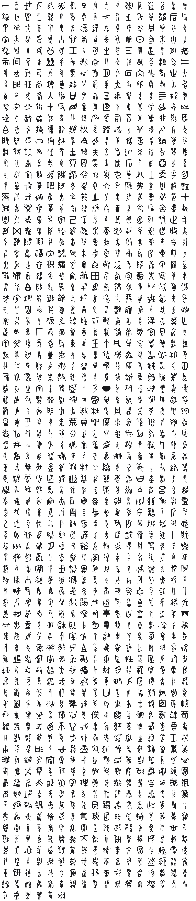

<br/>
<br/>
<br/>
<br/>
<br/>
<br/>
<br/>

<h3 align='center'>bronze-script</h3>
<p align='center'>
  A Chinese Bronze Inscription Font
</p>

<br/>
<br/>
<br/>

## Introduction

**MarkBronzeScript** carries the writing tradition that followed oracle bone
script onto
[bronze vessels](https://en.wikipedia.org/wiki/Chinese_bronze_inscriptions)
used for rituals and record-keeping. Dating to roughly **1000-700 BCE**,
these inscriptions were cast directly into the surface of the metal
rather than carved. Where oracle bone script was scratched into shell and
bone for divination, bronze inscriptions commemorated events, recorded
offerings, and marked the possessions of kings and nobles.

The shift from bone to bronze brought rounder, more flowing forms. The
writing became more standardized as it moved from the private realm of
divination into the public sphere of ceremony and governance.

## Background

Drawing from the meticulous digital archive of **Richard Sears**'
website, [hanziyuan.net](https://hanziyuan.net), which he started
putting together in the early 2000s, which later grew through community
contributions, this font selects representative forms from the many
ancient glyph samples he documented (we used his drawings as inspiration
and redrew them on our own).

Each glyph is a **cleaned and redrawn** version of one of those early
inscriptions, chosen to convey the essence of the ancient sign rather
than reproduce every archaeological variation. Some bronze glyphs exist
in only a single instance, others appear in dozens of discovered forms.
This font offers one clear, approachable version of each.

It's not meant as an academic reconstruction, but as a **visual
bridge**, a way to appreciate the ancient aesthetic and spirit of early
Chinese characters without getting lost in the technical layers of
paleography. For full scholarly reference and authentic glyph records,
visit [hanziyuan.net](https://hanziyuan.net).

## Font

| font family | signs | code points |
| :---------- | :---- | :---------- |
| `MarkBronzeScript` | 1326 | U+F0022 to U+F054F |

Every sign sits on its own code point in Unicode's plane 15 private use
area. No sign is on a real Unicode character, so a sign copied out of
this font never pastes as another script's letter, and no other font
draws one by mistake. A private use point means something only in this
font: text written in it should keep each sign's name beside it.

The points are fixed in [`code-points.json`](../../code-points.json) at
the package root, keyed `bronze-script/<sign name>`, and never move. Each
sign's name and point are in [`./base/mapping.json`](./base/mapping.json),
in sign order. Signs are named by the modern Chinese character each is read as (`人`). The sign is drawn on its own private use point, never on that character.

To type or copy a sign, find its name in `mapping.json` and write its
point in text set in `MarkBronzeScript`: `䜣` is U+F0022, written
`&#xF0022;` in HTML or `'\u{F0022}'` in JavaScript. Or open [`./test/grid.html`](./test/grid.html)
in a browser, which shows every sign with its name and point on hover,
and copy from there.

Fonts are in the
[`./base`](https://github.com/cluesurf/mark/tree/make/base/bronze-script/base)
folder (`MarkBronzeScript-Regular.otf`), built from the
drawings in [`./base/mark`](./base/mark) by
[`./code/make-font.ts`](./code/make-font.ts). From the package root:

```bash
pnpm assign --write          # a point for each new drawing, never moving one
pnpm make:fonts bronze-script
pnpm make:grids
pnpm make:readmes
pnpm check:fonts             # every glyph on its manifest point, all in plane 15
```

## Glyphs

<p align='center'>
  
</p>

## License

[OFL](./license.md)

## ClueSurf

Made by [ClueSurf](https://clue.surf), meditating on the universe ¤.
Follow the work on [YouTube](https://youtube.com/@cluesurf),
[X](https://x.com/cluesurf),
[Instagram](https://instagram.com/cluesurf),
[Substack](https://cluesurf.substack.com),
[Facebook](https://facebook.com/cluesurf), and
[LinkedIn](https://linkedin.com/company/cluesurf), and browse more of
our open-source work here on [GitHub](https://github.com/cluesurf).
