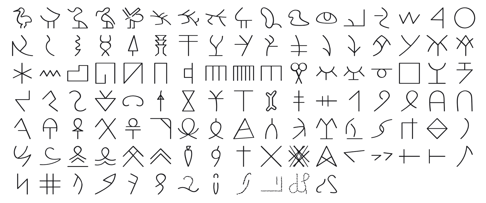

<br/>
<br/>
<br/>
<br/>
<br/>
<br/>
<br/>

<h3 align='center'>byblos-script</h3>
<p align='center'>
  A Byblos Syllabary Font
</p>

<br/>
<br/>
<br/>

## Introduction

**MarkByblosScript** preserves the signs of the
[Byblos syllabary](https://en.wikipedia.org/wiki/Byblos_syllabary), the
script also called **pseudo-hieroglyphic** for the way its shapes echo
Egyptian hieroglyphs without behaving like them. It was written in the
Phoenician port city of Byblos, modern Jbeil in Lebanon, between roughly
**2000 and 1500 BCE**.

The script survives on a very small set of objects. Bronze tablets,
bronze spatulas, and a handful of stone fragments, most of them
recovered from the Byblos excavations. That thin corpus is the whole
reason the script is still **undeciphered**. There is no bilingual key,
and the surviving texts are too short to give the repetitions a
decipherment needs.

Byblos sits at the exact spot where writing turned a corner. Egyptian
hieroglyphs were the visual model, the Levant was the ground where the
alphabet would be invented a few centuries later, and this script is the
middle term. Its shapes are Egyptian, its inventory is not.

## Background

Each glyph is a **cleaned and redrawn** version of a sign from the
Byblos corpus, keyed by the group letter and number used to catalogue
it, from `A.1` through `I.12`. Byblos signs vary widely in proportion,
with some tall and narrow, others wide and squat. The font preserves
these natural proportions, scaling each glyph uniformly by height and
adjusting its advance width to match.

It's not meant as an academic reconstruction, but as a **visual
bridge**, a way to appreciate the aesthetic and spirit of Byblos writing
without getting lost in the technical layers of its decipherment
debates.

## Source

The corpus and sign catalogue follow Maurice Dunand's excavation
publication, still the standard reference:

- Maurice Dunand, _Byblia Grammata: Documents et recherches sur le
  développement de l'écriture en Phénicie_ (Beirut, 1945).

Dunand excavated Byblos through the late 1920s and 1930s and gathered
the pseudo-hieroglyphic documents into a single catalogue. The sign
count is the key fact about the script. Around **a hundred distinct
signs** is far too many for an alphabet and far too few for a
logographic system like Egyptian, which is why the script is generally
read as a **syllabary**.

## Signs

The 114 signs are grouped by shape family, following the lettered
catalogue:

| group | # signs | keys         |
| :---- | :------ | :----------- |
| `A`   | 21      | `A.1`-`A.21` |
| `B`   | 13      | `B.1`-`B.13` |
| `C`   | 2       | `C.1`-`C.2`  |
| `D`   | 9       | `D.1`-`D.9`  |
| `E`   | 26      | `E.1`-`E.26` |
| `F`   | 6       | `F.1`-`F.6`  |
| `G`   | 17      | `G.1`-`G.17` |
| `H`   | 8       | `H.1`-`H.8`  |
| `I`   | 12      | `I.1`-`I.12` |

## Font

| font family | signs | code points |
| :---------- | :---- | :---------- |
| `MarkByblosScript` | 114 | U+F152D to U+F159E |

Every sign sits on its own code point in Unicode's plane 15 private use
area. No sign is on a real Unicode character, so a sign copied out of
this font never pastes as another script's letter, and no other font
draws one by mistake. A private use point means something only in this
font: text written in it should keep each sign's name beside it.

The points are fixed in [`code-points.json`](../../code-points.json) at
the package root, keyed `byblos-script/<sign name>`, and never move. Each
sign's name and point are in [`./base/mapping.json`](./base/mapping.json),
in sign order. Signs are named by group letter and number (`A.1` to `I.12`), in that order. The script is undeciphered: the names are catalogue numbers, not readings.

To type or copy a sign, find its name in `mapping.json` and write its
point in text set in `MarkByblosScript`: `A.1` is U+F152D, written
`&#xF152D;` in HTML or `'\u{F152D}'` in JavaScript. Or open [`./test/grid.html`](./test/grid.html)
in a browser, which shows every sign with its name and point on hover,
and copy from there.

Fonts are in the
[`./base`](https://github.com/cluesurf/mark/tree/make/base/byblos-script/base)
folder (`MarkByblosScript-Regular.otf`), built from the
drawings in [`./base/mark`](./base/mark) by
[`./code/make-font.ts`](./code/make-font.ts). From the package root:

```bash
pnpm assign --write          # a point for each new drawing, never moving one
pnpm make:fonts byblos-script
pnpm make:grids
pnpm make:readmes
pnpm check:fonts             # every glyph on its manifest point, all in plane 15
```

## Glyphs

<p align='center'>
  
</p>

## License

[OFL](./license.md)

## ClueSurf

Made by [ClueSurf](https://clue.surf), meditating on the universe ¤.
Follow the work on [YouTube](https://youtube.com/@cluesurf),
[X](https://x.com/cluesurf),
[Instagram](https://instagram.com/cluesurf),
[Substack](https://cluesurf.substack.com),
[Facebook](https://facebook.com/cluesurf), and
[LinkedIn](https://linkedin.com/company/cluesurf), and browse more of
our open-source work here on [GitHub](https://github.com/cluesurf).
