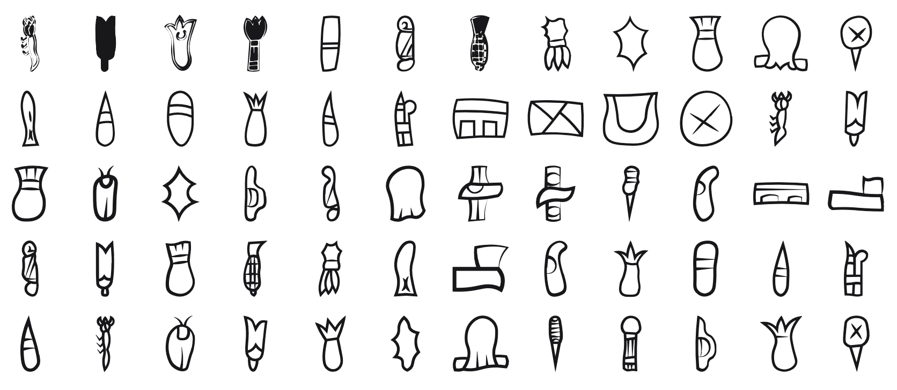

<br/>
<br/>
<br/>
<br/>
<br/>
<br/>
<br/>

<h3 align='center'>cascajal</h3>
<p align='center'>
  A Cascajal Block (Olmec) Script Font
</p>

<br/>
<br/>
<br/>

## Introduction

**MarkCascajal** preserves the signs of the
[Cascajal Block](https://en.wikipedia.org/wiki/Cascajal_Block), a
serpentine slab discovered near San Lorenzo in Veracruz, Mexico, and
associated with the **Olmec** civilization. Dated to roughly **900
BCE**, it carries what many scholars regard as the **oldest writing in
the Americas**.

The block bears 62 incised signs, some repeated, arranged in horizontal
rows rather than columns. The glyphs depict insects, plants, tools, and
abstract forms. No other text in the same system has ever been found,
which leaves the block undeciphered and its script an isolated,
tantalizing glimpse of the earliest American writing.

## Background

Each glyph is a **cleaned and redrawn** version of a sign from the
Cascajal Block, chosen to convey the essential shape of the figure
rather than reproduce every carved variation. Cascajal signs vary widely
in proportion, with some tall and narrow, others wide and squat. The font
preserves these natural proportions, scaling each glyph uniformly by
height and adjusting its advance width to match.

It's not meant as an academic reconstruction, but as a **visual
bridge**, a way to appreciate the ancient aesthetic and spirit of the
Americas' earliest writing without getting lost in the technical layers
of its decipherment debates.

## Font

| font family | signs | code points |
| :---------- | :---- | :---------- |
| `MarkCascajal` | 62 | U+F0550 to U+F058D |

Every sign sits on its own code point in Unicode's plane 15 private use
area. No sign is on a real Unicode character, so a sign copied out of
this font never pastes as another script's letter, and no other font
draws one by mistake. A private use point means something only in this
font: text written in it should keep each sign's name beside it.

The points are fixed in [`code-points.json`](../../code-points.json) at
the package root, keyed `cascajal/<sign name>`, and never move. Each
sign's name and point are in [`./base/mapping.json`](./base/mapping.json),
in sign order. Signs are named by catalogue number. The script is undeciphered: the names are not readings.

To type or copy a sign, find its name in `mapping.json` and write its
point in text set in `MarkCascajal`: `1` is U+F0550, written
`&#xF0550;` in HTML or `'\u{F0550}'` in JavaScript. Or open [`./test/grid.html`](./test/grid.html)
in a browser, which shows every sign with its name and point on hover,
and copy from there.

Fonts are in the
[`./base`](https://github.com/cluesurf/mark/tree/make/base/cascajal/base)
folder (`MarkCascajal-Regular.otf`), built from the
drawings in [`./base/mark`](./base/mark) by
[`./code/make-font.ts`](./code/make-font.ts). From the package root:

```bash
pnpm assign --write          # a point for each new drawing, never moving one
pnpm make:fonts cascajal
pnpm make:grids
pnpm make:readmes
pnpm check:fonts             # every glyph on its manifest point, all in plane 15
```

## Glyphs

<p align='center'>
  
</p>

## License

[OFL](./license.md)

## ClueSurf

Made by [ClueSurf](https://clue.surf), meditating on the universe ¤.
Follow the work on [YouTube](https://youtube.com/@cluesurf),
[X](https://x.com/cluesurf),
[Instagram](https://instagram.com/cluesurf),
[Substack](https://cluesurf.substack.com),
[Facebook](https://facebook.com/cluesurf), and
[LinkedIn](https://linkedin.com/company/cluesurf), and browse more of
our open-source work here on [GitHub](https://github.com/cluesurf).
