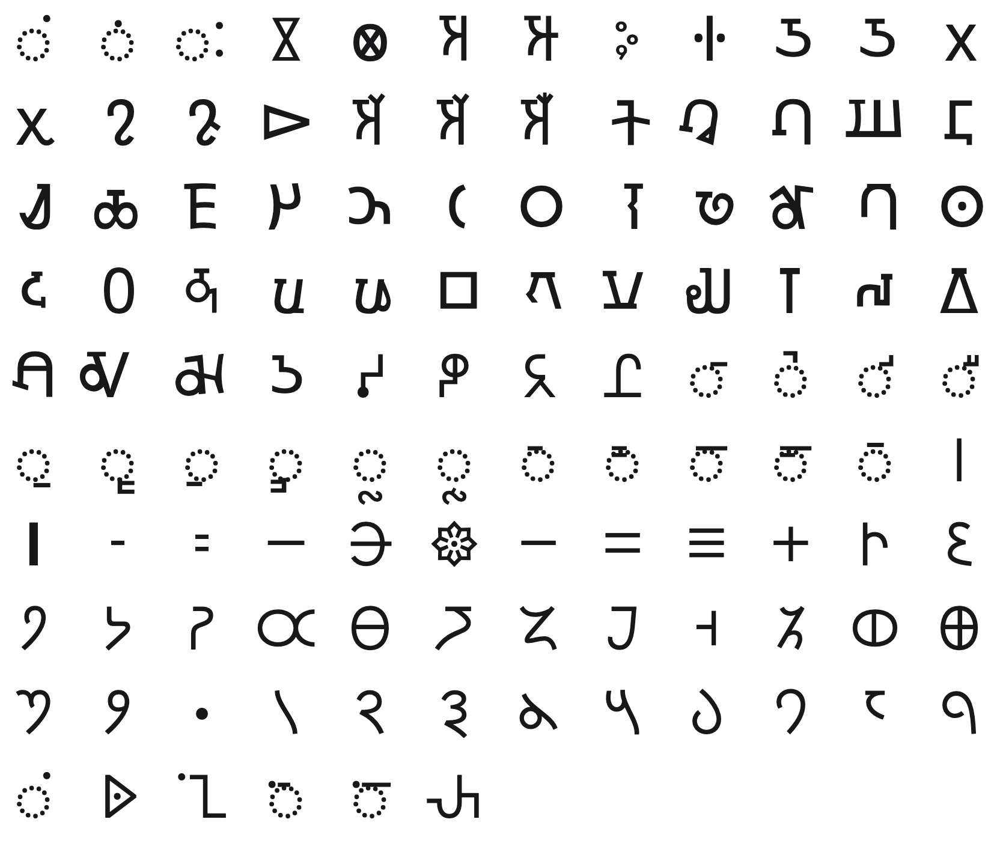

<br/>
<br/>
<br/>
<br/>
<br/>
<br/>
<br/>

<h3 align='center'>gupta</h3>
<p align='center'>
  A Gupta Script Font
</p>

<br/>
<br/>
<br/>

## Introduction

**MarkGupta** renders the script of the
[Gupta Empire](https://en.wikipedia.org/wiki/Gupta_script), the golden
age of classical India spanning roughly **320-550 CE**. The Gupta script
descended from Brahmi and served as the writing system for Sanskrit
during an era of extraordinary achievement in mathematics, astronomy,
literature, and philosophy. It was during this period that the concept of
zero was formalized, that Kalidasa wrote his great poems, and that
Indian culture radiated outward across Asia.

The Gupta script stands at a crossroads in the history of writing. It
is the ancestor of Nagari, which became Devanagari, the script used for
Hindi, Sanskrit, and many other South Asian languages today. It also
gave rise to the scripts of Southeast Asia, from Khmer to Javanese to
Tibetan. Each glyph carries the genetic code of a vast family of
writing systems.

## Font

| font family | signs | code points |
| :---------- | :---- | :---------- |
| `MarkGupta` | 48 | U+F159F to U+F15CE |

Every sign sits on its own code point in Unicode's plane 15 private use
area. No sign is on a real Unicode character, so a sign copied out of
this font never pastes as another script's letter, and no other font
draws one by mistake. A private use point means something only in this
font: text written in it should keep each sign's name beside it.

The points are fixed in [`code-points.json`](../../code-points.json) at
the package root, keyed `gupta/<sign name>`, and never move. Each
sign's name and point are in [`./base/mapping.json`](./base/mapping.json),
in sign order. Letters are named as the Brahmi letters they correspond to (`a`, `ka`, `vocalic-r`), in Brahmi order.

To type or copy a sign, find its name in `mapping.json` and write its
point in text set in `MarkGupta`: `upadhmaniya` is U+F159F, written
`&#xF159F;` in HTML or `'\u{F159F}'` in JavaScript. Or open [`./test/grid.html`](./test/grid.html)
in a browser, which shows every sign with its name and point on hover,
and copy from there.

Fonts are in the
[`./base`](https://github.com/cluesurf/mark/tree/make/base/gupta/base)
folder (`MarkGupta-Regular.otf`), built from the
drawings in [`./base/mark`](./base/mark) by
[`./code/make-font.ts`](./code/make-font.ts). From the package root:

```bash
pnpm assign --write          # a point for each new drawing, never moving one
pnpm make:fonts gupta
pnpm make:grids
pnpm make:readmes
pnpm check:fonts             # every glyph on its manifest point, all in plane 15
```

## Glyphs

<p align='center'>
  
</p>

## License

[OFL](./license.md)

## ClueSurf

Made by [ClueSurf](https://clue.surf), meditating on the universe ¤.
Follow the work on [YouTube](https://youtube.com/@cluesurf),
[X](https://x.com/cluesurf),
[Instagram](https://instagram.com/cluesurf),
[Substack](https://cluesurf.substack.com),
[Facebook](https://facebook.com/cluesurf), and
[LinkedIn](https://linkedin.com/company/cluesurf), and browse more of
our open-source work here on [GitHub](https://github.com/cluesurf).
