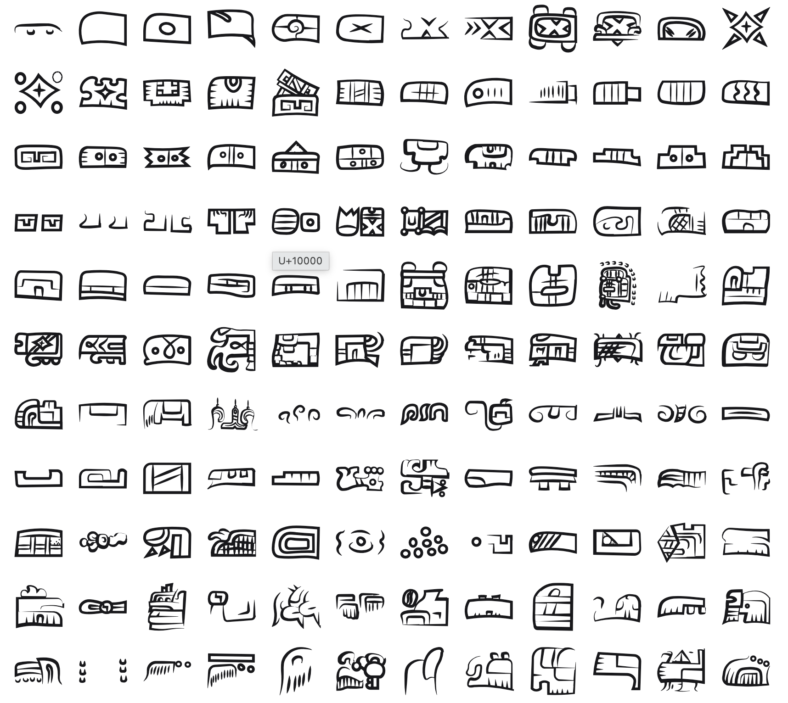

<br/>
<br/>
<br/>
<br/>
<br/>
<br/>
<br/>

<h3 align='center'>isthmian-script</h3>
<p align='center'>
  An Isthmian (Epi-Olmec) Script Font
</p>

<br/>
<br/>
<br/>

## Introduction

**MarkIsthmianScript** preserves the glyphs of the
[Isthmian script](https://en.wikipedia.org/wiki/Isthmian_script), also
known as **Epi-Olmec**, one of the earliest writing systems of
Mesoamerica. It appears on a small handful of surviving artifacts from
the Isthmus of Tehuantepec in southern Mexico, most famously the **La
Mojarra Stela** and the **Tuxtla Statuette**, dating to roughly **300
BCE to 500 CE**.

The script is written in vertical columns and combines logographic and
syllabic signs. With only a few inscriptions known, its reading remains
contested. A partial decipherment has been proposed, but with so little
surviving text the system stays largely locked, one of the great
undeciphered scripts of the ancient Americas.

## Background

Each glyph is a **cleaned and redrawn** version of a sign from the
surviving Isthmian inscriptions, chosen to convey the essential shape of
the figure rather than reproduce every carved variation. Isthmian signs
vary widely in proportion, with some tall and narrow, others wide and
squat. The font preserves these natural proportions, scaling each glyph
uniformly by height and adjusting its advance width to match.

It's not meant as an academic reconstruction, but as a **visual
bridge**, a way to appreciate the ancient aesthetic and spirit of
Mesoamerica's early writing without getting lost in the technical layers
of its decipherment debates.

## Font

| font family | signs | code points |
| :---------- | :---- | :---------- |
| `MarkIsthmianScript` | 185 | U+F058E to U+F0646 |

Every sign sits on its own code point in Unicode's plane 15 private use
area. No sign is on a real Unicode character, so a sign copied out of
this font never pastes as another script's letter, and no other font
draws one by mistake. A private use point means something only in this
font: text written in it should keep each sign's name beside it.

The points are fixed in [`code-points.json`](../../code-points.json) at
the package root, keyed `isthmian-script/<sign name>`, and never move. Each
sign's name and point are in [`./base/mapping.json`](./base/mapping.json),
in sign order. Signs are named by catalogue number. The script is undeciphered: the names are not readings.

To type or copy a sign, find its name in `mapping.json` and write its
point in text set in `MarkIsthmianScript`: `100` is U+F058E, written
`&#xF058E;` in HTML or `'\u{F058E}'` in JavaScript. Or open [`./test/grid.html`](./test/grid.html)
in a browser, which shows every sign with its name and point on hover,
and copy from there.

Fonts are in the
[`./base`](https://github.com/cluesurf/mark/tree/make/base/isthmian-script/base)
folder (`MarkIsthmianScript-Regular.otf`), built from the
drawings in [`./base/mark`](./base/mark) by
[`./code/make-font.ts`](./code/make-font.ts). From the package root:

```bash
pnpm assign --write          # a point for each new drawing, never moving one
pnpm make:fonts isthmian-script
pnpm make:grids
pnpm make:readmes
pnpm check:fonts             # every glyph on its manifest point, all in plane 15
```

## Glyphs

<p align='center'>
  
</p>

## License

[OFL](./license.md)

## ClueSurf

Made by [ClueSurf](https://clue.surf), meditating on the universe ¤.
Follow the work on [YouTube](https://youtube.com/@cluesurf),
[X](https://x.com/cluesurf),
[Instagram](https://instagram.com/cluesurf),
[Substack](https://cluesurf.substack.com),
[Facebook](https://facebook.com/cluesurf), and
[LinkedIn](https://linkedin.com/company/cluesurf), and browse more of
our open-source work here on [GitHub](https://github.com/cluesurf).
