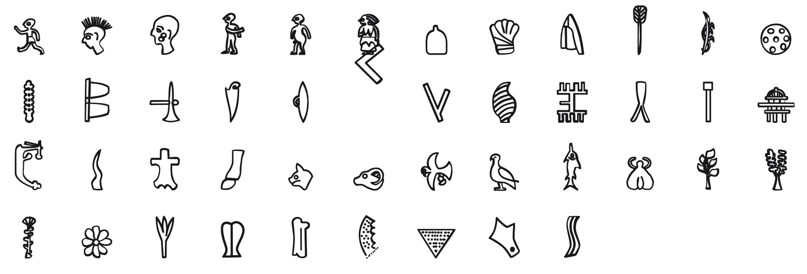

<br/>
<br/>
<br/>
<br/>
<br/>
<br/>
<br/>

<h3 align='center'>phaistos-disk</h3>
<p align='center'>
  A Phaistos Disc Font
</p>

<br/>
<br/>
<br/>

## Introduction

**MarkPhaistosDisc** captures the mysterious symbols stamped into the
[Phaistos Disc](https://en.wikipedia.org/wiki/Phaistos_Disc), a fired
clay tablet discovered in 1908 at the Minoan palace of Phaistos on
Crete. Dating to around **1700 BCE**, the disc bears 242 impressions of
45 distinct signs, spiraling inward on both sides, making it one of the
earliest known examples of movable-type printing.

No one has deciphered it. The signs depict people, animals, plants,
tools, and abstract shapes. They belong to no other known writing
system. Each glyph was pressed into wet clay using a set of hand-carved
punches, each symbol a small stamp repeated across the disc's surface.
Whether it records a prayer, a story, a list, or something else
entirely remains an open question.

## Font

| font family | signs | code points |
| :---------- | :---- | :---------- |
| `MarkPhaistosDisc` | 48 | U+F0D71 to U+F0DA1 |

Every sign sits on its own code point in Unicode's plane 15 private use
area. No sign is on a real Unicode character, so a sign copied out of
this font never pastes as another script's letter, and no other font
draws one by mistake. A private use point means something only in this
font: text written in it should keep each sign's name beside it.

The points are fixed in [`code-points.json`](../../code-points.json) at
the package root, keyed `phaistos-disk/<sign name>`, and never move. Each
sign's name and point are in [`./base/mapping.json`](./base/mapping.json),
in sign order. Signs are named by Evans's number (`01` to `49`). The script is undeciphered: the names are not readings. 1 assigned sign has no drawing yet (`18`), so the font has no glyph for it.

To type or copy a sign, find its name in `mapping.json` and write its
point in text set in `MarkPhaistosDisc`: `01` is U+F0D71, written
`&#xF0D71;` in HTML or `'\u{F0D71}'` in JavaScript. Or open [`./test/grid.html`](./test/grid.html)
in a browser, which shows every sign with its name and point on hover,
and copy from there.

Fonts are in the
[`./base`](https://github.com/cluesurf/mark/tree/make/base/phaistos-disk/base)
folder (`MarkPhaistosDisc-Regular.otf`), built from the
drawings in [`./base/mark`](./base/mark) by
[`./code/make-font.ts`](./code/make-font.ts). From the package root:

```bash
pnpm assign --write          # a point for each new drawing, never moving one
pnpm make:fonts phaistos-disk
pnpm make:grids
pnpm make:readmes
pnpm check:fonts             # every glyph on its manifest point, all in plane 15
```

## Glyphs

<p align='center'>
  
</p>

Evans's 45 named signs, each on its plane 15 point (the font also
draws the drawings numbered 46 to 49):

| # | name | codepoint |
| :--: | :--- | :-------- |
| 01 | Pedestrian | U+F0D71 |
| 02 | Plumed head | U+F0D72 |
| 03 | Tattooed head | U+F0D73 |
| 04 | Captive | U+F0D74 |
| 05 | Child | U+F0D75 |
| 06 | Woman | U+F0D76 |
| 07 | Helmet | U+F0D77 |
| 08 | Gauntlet | U+F0D78 |
| 09 | Tiara | U+F0D79 |
| 10 | Arrow | U+F0D7A |
| 11 | Bow | U+F0D7B |
| 12 | Shield | U+F0D7C |
| 13 | Club | U+F0D7D |
| 14 | Manacles | U+F0D7E |
| 15 | Mattock | U+F0D7F |
| 16 | Saw | U+F0D80 |
| 17 | Lid | U+F0D81 |
| 18 | Boomerang | U+F0D82 (no drawing yet) |
| 19 | Carpentry plane | U+F0D83 |
| 20 | Dolium | U+F0D84 |
| 21 | Comb | U+F0D85 |
| 22 | Sling | U+F0D86 |
| 23 | Column | U+F0D87 |
| 24 | Beehive | U+F0D88 |
| 25 | Ship | U+F0D89 |
| 26 | Horn | U+F0D8A |
| 27 | Hide | U+F0D8B |
| 28 | Bulls leg | U+F0D8C |
| 29 | Cat | U+F0D8D |
| 30 | Ram | U+F0D8E |
| 31 | Eagle | U+F0D8F |
| 32 | Dove | U+F0D90 |
| 33 | Tunny | U+F0D91 |
| 34 | Bee | U+F0D92 |
| 35 | Plane tree | U+F0D93 |
| 36 | Vine | U+F0D94 |
| 37 | Papyrus | U+F0D95 |
| 38 | Rosette | U+F0D96 |
| 39 | Lily | U+F0D97 |
| 40 | Ox back | U+F0D98 |
| 41 | Flute | U+F0D99 |
| 42 | Grater | U+F0D9A |
| 43 | Strainer | U+F0D9B |
| 44 | Small axe | U+F0D9C |
| 45 | Wavy band | U+F0D9D |

Fonts are in the
[`./base`](https://github.com/cluesurf/mark/tree/make/base/phaistos-disk/base)
folder.

## License

[OFL](./license.md)

## ClueSurf

Made by [ClueSurf](https://clue.surf), meditating on the universe ¤.
Follow the work on [YouTube](https://youtube.com/@cluesurf),
[X](https://x.com/cluesurf),
[Instagram](https://instagram.com/cluesurf),
[Substack](https://cluesurf.substack.com),
[Facebook](https://facebook.com/cluesurf), and
[LinkedIn](https://linkedin.com/company/cluesurf), and browse more of
our open-source work here on [GitHub](https://github.com/cluesurf).
