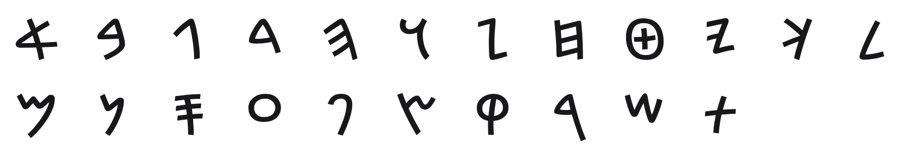

<br/>
<br/>
<br/>
<br/>
<br/>
<br/>
<br/>

<h3 align='center'>proto-canaanite</h3>
<p align='center'>
  A Proto-Canaanite Font
</p>

<br/>
<br/>
<br/>

## Introduction

**MarkProtoCanaanite** captures the script that bridged Proto-Sinaitic
writing and the Phoenician alphabet. Emerging in the land of Canaan
around **1600-1200 BCE**, the
[Proto-Canaanite script](https://en.wikipedia.org/wiki/Proto-Canaanite_script)
represents the critical middle chapter in the story of the alphabet.
Where Proto-Sinaitic scratched the first letters into stone, Proto-
Canaanite carried them forward, refining pictographs into increasingly
abstract letterforms.

These glyphs were found on pottery, bronze daggers, and scattered
artifacts across the Levant. They show writing in transition, the
recognizable shapes of animals and body parts gradually simplifying into
the streamlined signs that the Phoenicians would standardize and spread
across the Mediterranean. From there the alphabet passed to Greek, then
Latin, then to the letters used across the world today.

## Font

| font family | signs | code points |
| :---------- | :---- | :---------- |
| `MarkProtoCanaanite` | 21 | U+F1770 to U+F1784 |

Every sign sits on its own code point in Unicode's plane 15 private use
area. No sign is on a real Unicode character, so a sign copied out of
this font never pastes as another script's letter, and no other font
draws one by mistake. A private use point means something only in this
font: text written in it should keep each sign's name beside it.

The points are fixed in [`code-points.json`](../../code-points.json) at
the package root, keyed `proto-canaanite/<sign name>`, and never move. Each
sign's name and point are in [`./base/mapping.json`](./base/mapping.json),
in sign order. Letters are named as the Phoenician letters they became (`alf`, `bet`), in alphabet order. There is no `ain`.

To type or copy a sign, find its name in `mapping.json` and write its
point in text set in `MarkProtoCanaanite`: `alf` is U+F1770, written
`&#xF1770;` in HTML or `'\u{F1770}'` in JavaScript. Or open [`./test/grid.html`](./test/grid.html)
in a browser, which shows every sign with its name and point on hover,
and copy from there.

Fonts are in the
[`./base`](https://github.com/cluesurf/mark/tree/make/base/proto-canaanite/base)
folder (`MarkProtoCanaanite-Regular.otf`), built from the
drawings in [`./base/mark`](./base/mark) by
[`./code/make-font.ts`](./code/make-font.ts). From the package root:

```bash
pnpm assign --write          # a point for each new drawing, never moving one
pnpm make:fonts proto-canaanite
pnpm make:grids
pnpm make:readmes
pnpm check:fonts             # every glyph on its manifest point, all in plane 15
```

## Glyphs

<p align='center'>
  
</p>

## License

[OFL](./license.md)

## ClueSurf

Made by [ClueSurf](https://clue.surf), meditating on the universe ¤.
Follow the work on [YouTube](https://youtube.com/@cluesurf),
[X](https://x.com/cluesurf),
[Instagram](https://instagram.com/cluesurf),
[Substack](https://cluesurf.substack.com),
[Facebook](https://facebook.com/cluesurf), and
[LinkedIn](https://linkedin.com/company/cluesurf), and browse more of
our open-source work here on [GitHub](https://github.com/cluesurf).
