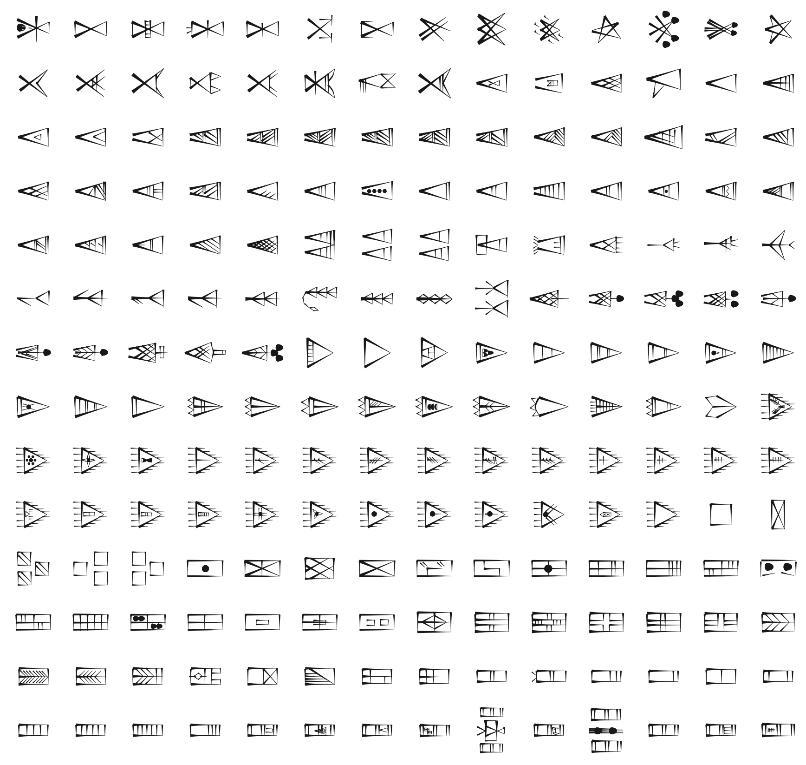

<br/>
<br/>
<br/>
<br/>
<br/>
<br/>
<br/>

<h3 align='center'>proto-elamite</h3>
<p align='center'>
  A Proto-Elamite Script Font
</p>

<br/>
<br/>
<br/>

## Introduction

**MarkProtoElamite** preserves the signs of
[Proto-Elamite](https://en.wikipedia.org/wiki/Proto-Elamite), one of the
oldest writing systems in the world. It was used across the Iranian
plateau, centered on **Susa**, from roughly **3100 to 2900 BCE**,
contemporary with the proto-cuneiform tablets of Mesopotamia.

The script survives mainly on clay accounting tablets and combines
numeric signs with hundreds of distinct pictographic and abstract signs.
Despite more than a century of study it remains **largely undeciphered**.
The numeral systems are partly understood, but the underlying language
and most non-numeric signs are still unread, making Proto-Elamite one of
the great undeciphered scripts of antiquity.

## Source

The glyph shapes are derived from the **CDLI** proto-Elamite sign list:

- [cdli-gh/proto-elamite_data](https://github.com/cdli-gh/proto-elamite_data),
  © Cuneiform Digital Library Initiative (CDLI), licensed under
  [Creative Commons Attribution 4.0 International (CC-BY-4.0)](https://creativecommons.org/licenses/by/4.0/).

The vector sign drawings from that corpus were converted, cleaned (a
handful carried scholarly break-hatching that was removed), and fit to a
consistent em. Each glyph keeps the corpus **M-number** as its key (for
example `M001`, `M006-B`, `M001+M379-C` for composite signs). See
[`./base/mapping.json`](./base/mapping.json) for the full
glyph-to-codepoint mapping.

## Font

| font family | signs | code points |
| :---------- | :---- | :---------- |
| `MarkProtoElamite` | 1329 | U+F0DA2 to U+F12D2 |

Every sign sits on its own code point in Unicode's plane 15 private use
area. No sign is on a real Unicode character, so a sign copied out of
this font never pastes as another script's letter, and no other font
draws one by mistake. A private use point means something only in this
font: text written in it should keep each sign's name beside it.

The points are fixed in [`code-points.json`](../../code-points.json) at
the package root, keyed `proto-elamite/<sign name>`, and never move. Each
sign's name and point are in [`./base/mapping.json`](./base/mapping.json),
in sign order. Signs are named by their CDLI sign name (`M001+M379-C`). The script is undeciphered: the names are not readings.

To type or copy a sign, find its name in `mapping.json` and write its
point in text set in `MarkProtoElamite`: `M001+M379-C` is U+F0DA2, written
`&#xF0DA2;` in HTML or `'\u{F0DA2}'` in JavaScript. Or open [`./test/grid.html`](./test/grid.html)
in a browser, which shows every sign with its name and point on hover,
and copy from there.

Fonts are in the
[`./base`](https://github.com/cluesurf/mark/tree/make/base/proto-elamite/base)
folder (`MarkProtoElamite-Regular.otf`), built from the
drawings in [`./base/mark`](./base/mark) by
[`./code/make-font.ts`](./code/make-font.ts). From the package root:

```bash
pnpm assign --write          # a point for each new drawing, never moving one
pnpm make:fonts proto-elamite
pnpm make:grids
pnpm make:readmes
pnpm check:fonts             # every glyph on its manifest point, all in plane 15
```

## Glyphs

<p align='center'>
  
</p>

## License

Font software: [OFL](./license.md). Glyph shapes derived from
[cdli-gh/proto-elamite_data](https://github.com/cdli-gh/proto-elamite_data)
under CC-BY-4.0 (see [`./license.md`](./license.md) for attribution).

## ClueSurf

Made by [ClueSurf](https://clue.surf), meditating on the universe ¤.
Follow the work on [YouTube](https://youtube.com/@cluesurf),
[X](https://x.com/cluesurf),
[Instagram](https://instagram.com/cluesurf),
[Substack](https://cluesurf.substack.com),
[Facebook](https://facebook.com/cluesurf), and
[LinkedIn](https://linkedin.com/company/cluesurf), and browse more of
our open-source work here on [GitHub](https://github.com/cluesurf).
