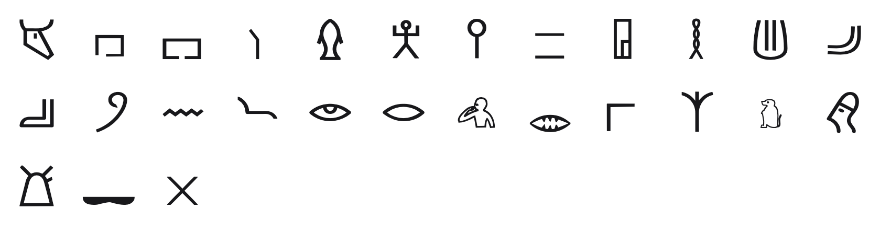

<br/>
<br/>
<br/>
<br/>
<br/>
<br/>
<br/>

<h3 align='center'>proto-sinaitic</h3>
<p align='center'>
  A Proto-Sinaitic Font
</p>

<br/>
<br/>
<br/>

## Introduction

**MarkProtoSinaitic** traces the ancient impulse to carve meaning into stone.
Based on Proto-Sinaitic script from around 1800 BCE, it captures that
pivotal moment when humans first abstracted pictographs into letters.
When miners in the Sinai Peninsula began scratching symbols that would
echo through millennia.

This was potentially one of humanity's leaps from depicting the world to
encoding language. From drawing what we see to marking what we say. Each
glyph a revolution carved in wall, transforming pictures into an
alphabet that would father Hebrew, Arabic, Greek, Latin, and the letters
you're reading now.

## Font

| font family | signs | code points |
| :---------- | :---- | :---------- |
| `MarkProtoSinaitic` | 27 | U+F1785 to U+F179F |

Every sign sits on its own code point in Unicode's plane 15 private use
area. No sign is on a real Unicode character, so a sign copied out of
this font never pastes as another script's letter, and no other font
draws one by mistake. A private use point means something only in this
font: text written in it should keep each sign's name beside it.

The points are fixed in [`code-points.json`](../../code-points.json) at
the package root, keyed `proto-sinaitic/<sign name>`, and never move. Each
sign's name and point are in [`./base/mapping.json`](./base/mapping.json),
in sign order. Signs are named by the Gardiner number of the Egyptian hieroglyph each is thought to come from (`F001`, the ox head), in Phoenician letter order. The font has a Regular and a Semibold, with the same signs on the same points.

To type or copy a sign, find its name in `mapping.json` and write its
point in text set in `MarkProtoSinaitic`: `F001` is U+F1785, written
`&#xF1785;` in HTML or `'\u{F1785}'` in JavaScript. Or open [`./test/grid.html`](./test/grid.html)
in a browser, which shows every sign with its name and point on hover,
and copy from there.

Fonts are in the
[`./base`](https://github.com/cluesurf/mark/tree/make/base/proto-sinaitic/base)
folder (`MarkProtoSinaitic-Regular.ttf`, `MarkProtoSinaitic-Semibold.ttf`), built from the
drawings in [`./base/mark`](./base/mark) by
[`./code/make-font.ts`](./code/make-font.ts). From the package root:

```bash
pnpm assign --write          # a point for each new drawing, never moving one
pnpm make:fonts proto-sinaitic
pnpm make:grids
pnpm make:readmes
pnpm check:fonts             # every glyph on its manifest point, all in plane 15
```

## Glyphs

<p align='center'>
  
</p>

The 27 signs, in Phoenician letter order. Each is named by the Gardiner
number of the Egyptian hieroglyph it is thought to come from, and sits
on its own plane 15 point. The last two columns are the real Unicode
Egyptian hieroglyph and Phoenician letter, for reference only (after the
[Wikipedia table](https://en.wikipedia.org/wiki/Proto-Sinaitic_script#Table_of_Symbols)):
this font draws nothing at those points.

| sign | code point | Egyptian | Phoenician |
| :--- | :--------- | :------: | :--------: |
| `F001` | U+F1785 | 𓃾 | 𐤀 |
| `O001` | U+F1786 | 𓉐 | 𐤁 |
| `O004` | U+F1787 | 𓉔 | 𐤁 |
| `T014` | U+F1788 | 𓌙 | 𐤂 |
| `K005` | U+F1789 | 𓆟 | 𐤃 |
| `A028` | U+F178A | 𓀠 | 𐤄 |
| `T003` | U+F178B | 𓌉 | 𐤅 |
| `Z016A` | U+F178C | 𓐅 | 𐤆 |
| `O006` | U+F178D | 𓉗 | 𐤇 |
| `V028` | U+F178E | 𓎛 | 𐤇 |
| `F035` | U+F178F | 𓄤 | 𐤈 |
| `D036` | U+F1790 | 𓂝 | 𐤉 |
| `D046` | U+F1791 | 𓂧 | 𐤊 |
| `V001` | U+F1792 | 𓍢 | 𐤋 |
| `N035` | U+F1793 | 𓈖 | 𐤌 |
| `I010` | U+F1794 | 𓆓 | 𐤍 |
| `D004` | U+F1795 | 𓁹 | 𐤏 |
| `D021` | U+F1796 | 𓂋 | 𐤐 |
| `A002` | U+F1797 | 𓀁 | 𐤄 |
| `D025` | U+F1798 | 𓂏 | 𐤐 |
| `O038` | U+F1799 | 𓊋 | 𐤐 |
| `M022` | U+F179A | 𓇑 | 𐤑 |
| `E036` | U+F179B | 𓃻 | 𐤒 |
| `D001` | U+F179C | 𓁶 | 𐤓 |
| `N006` | U+F179D | 𓇴 | 𐤔 |
| `T010` | U+F179E | 𓌔 | 𐤔 |
| `Z009` | U+F179F | 𓏴 | 𐤕 |

## License

[OFL](./license.md)

## ClueSurf

Made by [ClueSurf](https://clue.surf), meditating on the universe ¤.
Follow the work on [YouTube](https://youtube.com/@cluesurf),
[X](https://x.com/cluesurf),
[Instagram](https://instagram.com/cluesurf),
[Substack](https://cluesurf.substack.com),
[Facebook](https://facebook.com/cluesurf), and
[LinkedIn](https://linkedin.com/company/cluesurf), and browse more of
our open-source work here on [GitHub](https://github.com/cluesurf).
