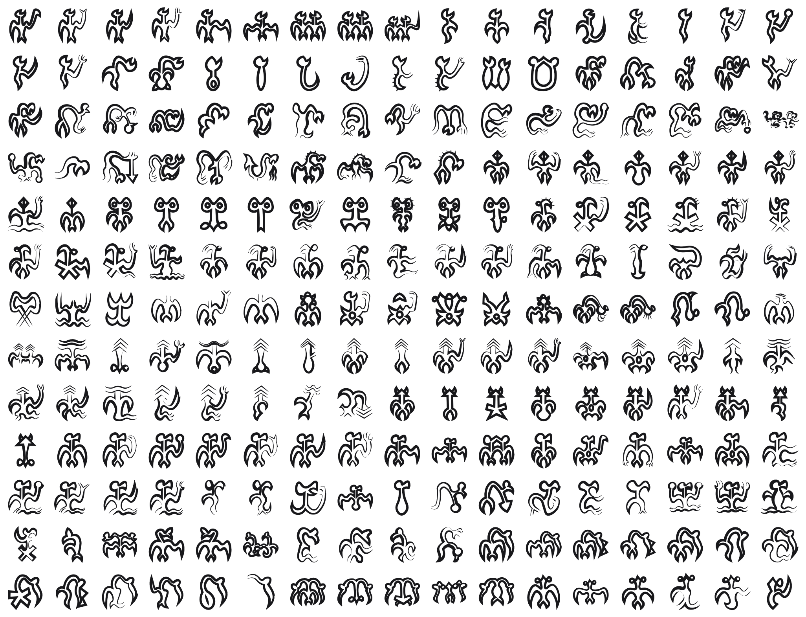

<br/>
<br/>
<br/>
<br/>
<br/>
<br/>
<br/>

<h3 align='center'>rongorongo</h3>
<p align='center'>
  A Rongorongo Script Font
</p>

<br/>
<br/>
<br/>

## Introduction

**MarkRongoRongo** preserves the mysterious glyphs of
[rongorongo](https://en.wikipedia.org/wiki/Rongorongo), a system of
markings discovered on **Easter Island (Rapa Nui)** in the 19th century.
Carved into wooden tablets with shark teeth and obsidian flakes, the
glyphs depict humans, birds, fish, plants, and abstract geometric
shapes, arranged in an unusual **reverse boustrophedon** layout where
every other line is rotated 180 degrees.

Whether rongorongo represents true writing, a mnemonic system, or a
proto-script remains debated. No one has been able to read it. Of the
roughly two dozen surviving tablets and inscribed objects, none can be
fully translated, making rongorongo one of the great undeciphered
scripts of the world.

## Background

This font draws on the comprehensive sign catalog at
[kohaumotu.org/rongorongo_org](http://kohaumotu.org/rongorongo_org/signs/g001099.html),
which documents the corpus of known rongorongo glyphs across all
surviving inscriptions. We used those reference forms as inspiration and
redrew each glyph cleanly for use as a font.

Each glyph is a **cleaned and redrawn** version of a sign from the
catalog, chosen to convey the essential shape of the figure rather than
reproduce every carving variation. Rongorongo glyphs vary widely in
proportion, with some tall and narrow, others wide and squat. The font
preserves these natural proportions, scaling each glyph uniformly by
height and adjusting its advance width to match.

It's not meant as an academic reconstruction, but as a **visual
bridge**, a way to appreciate the ancient aesthetic and spirit of Rapa
Nui's enigmatic script without getting lost in the technical layers of
its decipherment debates. For full scholarly reference and authentic
sign records, visit
[kohaumotu.org/rongorongo_org](http://kohaumotu.org/rongorongo_org/signs/g001099.html).

## Font

| font family | signs | code points |
| :---------- | :---- | :---------- |
| `MarkRongoRongo` | 601 | U+F12D3 to U+F152C |

Every sign sits on its own code point in Unicode's plane 15 private use
area. No sign is on a real Unicode character, so a sign copied out of
this font never pastes as another script's letter, and no other font
draws one by mistake. A private use point means something only in this
font: text written in it should keep each sign's name beside it.

The points are fixed in [`code-points.json`](../../code-points.json) at
the package root, keyed `rongorongo/<sign name>`, and never move. Each
sign's name and point are in [`./base/mapping.json`](./base/mapping.json),
in sign order. Signs are named by Barthel number (`001`). The script is undeciphered: the names are not readings. 1 assigned sign has no drawing yet (`199`), so the font has no glyph for it.

To type or copy a sign, find its name in `mapping.json` and write its
point in text set in `MarkRongoRongo`: `001` is U+F12D3, written
`&#xF12D3;` in HTML or `'\u{F12D3}'` in JavaScript. Or open [`./test/grid.html`](./test/grid.html)
in a browser, which shows every sign with its name and point on hover,
and copy from there.

Fonts are in the
[`./base`](https://github.com/cluesurf/mark/tree/make/base/rongorongo/base)
folder (`MarkRongoRongo-Regular.otf`), built from the
drawings in [`./base/mark`](./base/mark) by
[`./code/make-font.ts`](./code/make-font.ts). From the package root:

```bash
pnpm assign --write          # a point for each new drawing, never moving one
pnpm make:fonts rongorongo
pnpm make:grids
pnpm make:readmes
pnpm check:fonts             # every glyph on its manifest point, all in plane 15
```

## Glyphs

Here's some of them, many many more in the font.

<p align='center'>
  
</p>

## License

[OFL](./license.md)

## ClueSurf

Made by [ClueSurf](https://clue.surf), meditating on the universe ¤.
Follow the work on [YouTube](https://youtube.com/@cluesurf),
[X](https://x.com/cluesurf),
[Instagram](https://instagram.com/cluesurf),
[Substack](https://cluesurf.substack.com),
[Facebook](https://facebook.com/cluesurf), and
[LinkedIn](https://linkedin.com/company/cluesurf), and browse more of
our open-source work here on [GitHub](https://github.com/cluesurf).
